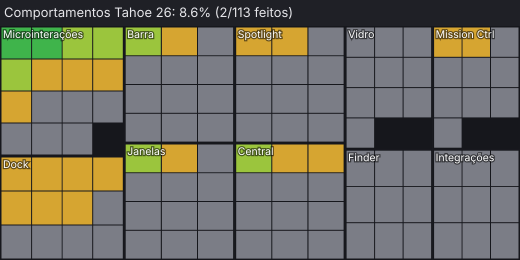
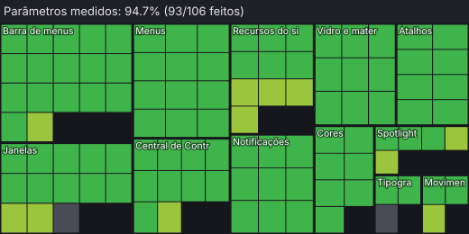
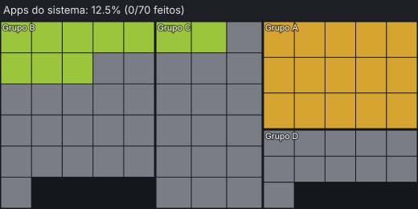
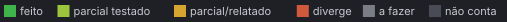

# hyprmac 🍎

> **Projeto para reproduzir o macOS Tahoe 26 em Linux (Hyprland + Wayland).**

`hyprmac` é uma camada de desktop com meta de fidelidade visual e comportamental ao **macOS Tahoe 26**. A base ainda contém referências rotuladas macOS 27 e métricas internas que precisam de validação específica contra Tahoe 26; veja [STATUS.md](STATUS.md).

## Status

<!-- status:inicio -->
  

<p>



</p>



Cada célula é um item: um comportamento da [lista de desejos](BaseConhecimento/LISTA-DE-DESEJOS.md), um parâmetro da [matriz](BaseConhecimento/comparacao/MATRIZ.md) ou um app do inventário Tahoe 26.6.1. Nota = feito 1 · parcial testado ½ · parcial/relatado ¼. Gerado por `scripts/status-map` a cada commit; mede o que está cadastrado, não a fidelidade global ao macOS.
<!-- status:fim -->

---

## 📸 Key Features

* **Liquid Glass Optics**: Native shaders via `hyprglass` implementing real lens refraction, continuous squircle curvature (`rounding_power = 3.2`), and specular bevel highlights.
* **macOS 34pt Menu Bar**: Integrated Waybar with functional Apple menu, dynamic application menu bar (File, Edit, View, Window, Help), privacy/camera indicators, and Tahoe status extras.
* **Control Center**: Dynamic concentric grid with tiles, circular buttons, brightness/volume sliders, and edit mode with widget gallery.
* **Spotlight (`⌘+Space`)**: Fast native launcher with modes (All, Files `⌘2`, Apps `⌘3`), instant mathematical calculation, search tokens, filter capsules, and recents.
* **Tahoe Dock**: Floating glass dock with app indicators, multiple icon styles (*Default*, *Dark*, *Clear*, *Tinted*), and launch animations.
* **Mission Control & Exposé (`⌃+↑`)**: Smooth window overview and desktop workspace management via `hyprmac-overview`.
* **Lock Screen (`hyprmac-lock`)**: Native Wayland session lock (`ext-session-lock-v1` + PAM) featuring SF Pro typography with additive vibrancy (`plus-lighter`) and responsive password feedback.
* **Screenshots (`⇧⌘3` / `⇧⌘4` / `⇧⌘5`)**: Interactive capture tools with floating thumbnail and screen recording support.
* **System Settings (`hyprmac-ajustes`)**: Comprehensive settings application mimicking macOS System Settings.
* **Busca e auditoria**: SQLite FTS5 com estados/proveniência das fontes e matriz interna de 106 parâmetros válidos. A nota da matriz não mede a fidelidade global ao Tahoe 26.

---

## 🚀 Quick Start & Installation

The repository contains an idempotent installation script that links configs and sets up dependencies while backing up existing user configurations:

Confira os problemas conhecidos de instalação em [STATUS.md](STATUS.md) antes de executar o script neste checkout.

```bash
# Clone or navigate to the repository
cd ~/Projects/hyprmac

# Run installer (default is dark mode)
./install.sh [dark|light]
```

### Runtime Services
After logging in, the following background processes run automatically:
* `waybar` — Top global menu bar
* `shell/hyprmac-shell` — Daemon powering Dock, Control Center, Spotlight, and Desktop Widgets
* `shell/hyprmac-overview` — Mission Control, iniciado sob demanda
* `shell/ocioso/hyprmac-ocioso` — Idle timer daemon

---

## 🗂️ Repository Architecture

| Directory | Purpose |
|---|---|
| [`shell/`](shell/) | Core Python/GTK Wayland layer-shell applications (Dock, Control Center, Settings, Lock) |
| [`hypr/`](hypr/) | Hyprland Lua configuration (`hyprmac.lua`) and Liquid Glass shader patches |
| [`waybar/`](waybar/) | Top menu bar configuration (`config.jsonc`) and dynamic menu scripts |
| [`gtk/`](gtk/) & [`kde/`](kde/) | GTK 3/4 CSS styling and Qt/KDE color schemes |
| [`scripts/`](scripts/) | CLI utilities for theme switching, window management, accessibility, and screenshots |
| [`BaseConhecimento/`](BaseConhecimento/) | Apple design knowledge base, design tokens, SQLite index, and compliance auditor |

---

## 📖 Essential Documentation for Developers & AI

* [**AGENTS.md**](AGENTS.md) — objetivo, regras e recuperação progressiva.
* [**ARCHITECTURE.md**](ARCHITECTURE.md) — módulos, tecnologias e fluxo atual.
* [**STATUS.md**](STATUS.md) — estado, problemas e prioridades.
* [**BaseConhecimento/README.md**](BaseConhecimento/README.md) — busca e fontes sob demanda.

---

## ⚖️ License & Attribution

Designed for personal Linux desktop customization inspired by Apple's Human Interface Guidelines.
All trademarks, icons, and interface references remain the property of their respective owners.
